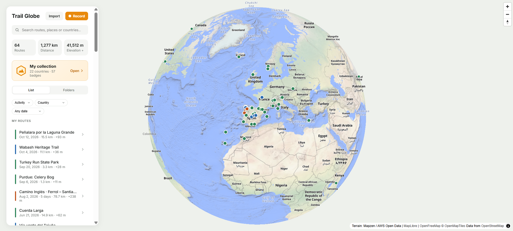
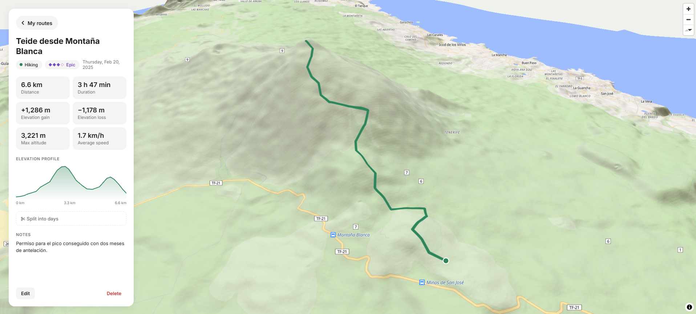
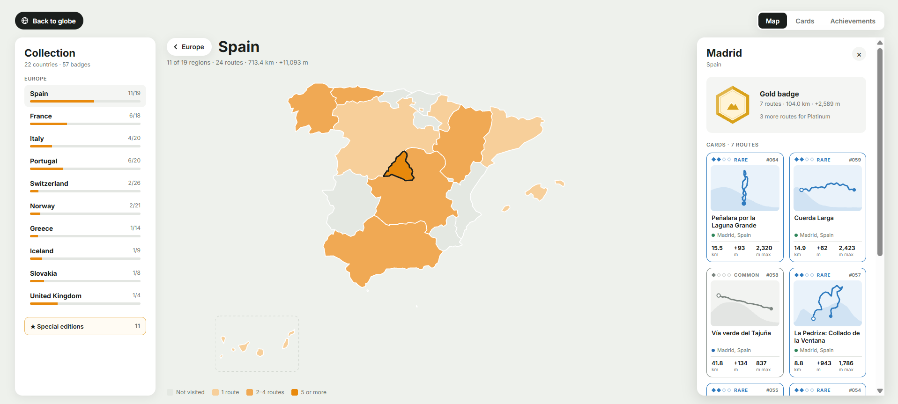
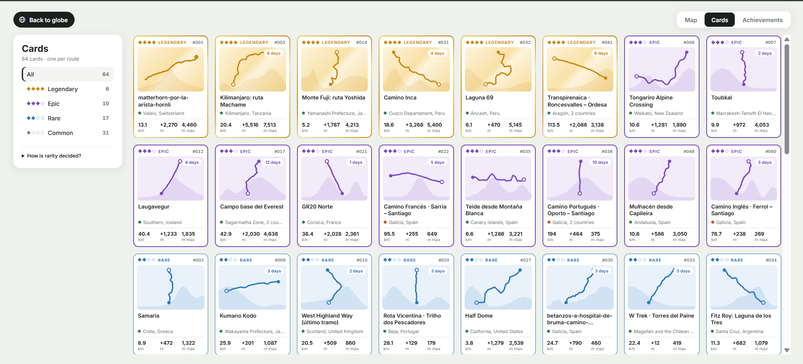
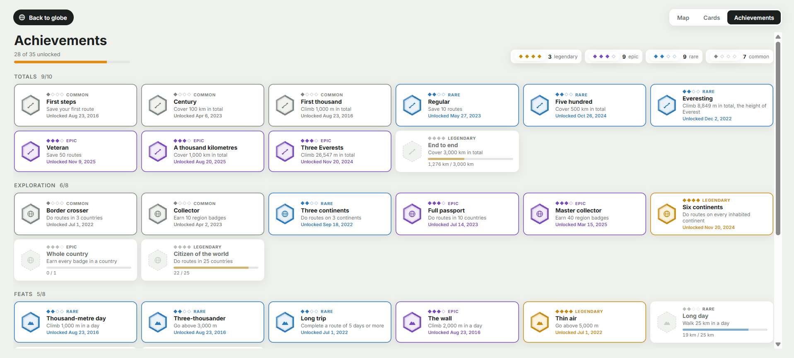

# Trail Globe

**A 3D diary of your hikes, bike rides and Camino stages, on an interactive globe.**

Import a GPX/KML file or record a route with your phone's GPS, see it on 3D terrain, and fill a collection of countries, regions, cards and achievements as you go.

**[Live demo → trail-globe.vercel.app](https://trail-globe.vercel.app)**. Press *Load sample routes* to see it with 61 routes from 22 countries.



<p align="center">
  
  
</p>
<p align="center">
  
  
</p>

## Features

- **3D globe.** Vector map with real terrain and hillshading. Every route is drawn on it, and opening one flies the camera to it.
- **Import or record.** Load GPX/KML files, or record with the GPS: live distance, elevation, speed, pause and resume. A recording survives the app being closed. On Android it keeps recording with the screen off.
- **Elevation that makes sense.** Phone GPS altitude is unreliable, so recorded tracks are corrected against a terrain elevation model (DEM) before saving.
- **Multi-day routes.** Stages are detected from time gaps in the track. Each day gets its own stats and notes, and a visual editor lets you split or join days.
- **Collection.** World → continent → country → region, with zoom transitions between levels. Every region you walk through earns a badge that levels up (bronze → platinum).
- **Cards and rarity.** Every route becomes a card: *Common, Rare, Epic or Legendary*. Rarity is computed from the effort of the hardest day ([Naismith's rule](https://en.wikipedia.org/wiki/Naismith%27s_rule): 100 m of climb ≈ 1 km on the flat), altitude and number of days.
- **35 achievements.** Totals, exploration, single-route feats, card rarity and consistency, each with its own rarity, unlock date and progress bar.
- **Folders, search and filters** by activity, date and country.
- **Installable (PWA)** and works offline. Responsive layout with a bottom sheet on mobile.

## Tech stack

| | |
|---|---|
| Frontend | Vanilla JavaScript (ES modules), HTML and CSS, no framework |
| Build | [Vite](https://vite.dev) |
| Map | [MapLibre GL JS](https://maplibre.org) (globe projection, terrain, hillshade) |
| Storage | IndexedDB via `idb-keyval`. Everything stays on the device, with no backend yet |
| Mobile | [Capacitor](https://capacitorjs.com) (Android) + background geolocation plugin |
| Hosting | Vercel |

## Some interesting bits

- **Which countries and regions a route crosses** is computed in the browser: points are sampled every 500 m and tested against Natural Earth polygons. A bounding-box prefilter skips almost every shape cheaply, and a route only counts in a region if it covers at least 1 km or 10% of its length there. The result is cached with the route.
- **Terrain elevation** is read straight from the colour of [Terrarium](https://github.com/tilezen/joerd/blob/master/docs/formats.md#terrarium) tile pixels (`height = R·256 + G + B/256 − 32768`) on a `<canvas>`. These are the same tiles the 3D terrain uses.
- **GPS noise filtering** drops fixes with more than 35 m of error, impossible jumps (over 160 km/h) and points that barely moved. Elevation gain uses a 3 m hysteresis threshold so jitter does not inflate it.
- **Zoom transitions** in the collection animate the SVG `viewBox` from the clicked continent or country to the next map, and the next map starts zoomed in when going back up. The zoom target ignores far-away territories, such as the Canary Islands or French Guiana.
- **Recording on Android** runs as a foreground service (the persistent "Recording route" notification). That is what lets it work with the screen off without asking for the stricter background-location permission.

## Project structure

```
src/
  main.js            app state, map layers and navigation
  ui.js, detail.js   home list and route detail
  collectionView.js  collection: world / continent / country maps, cards, achievements
  album.js, geo.js   which countries and regions each route crosses
  rarity.js, cards.js, achievements.js, medals.js
  recorder.js, tracker.js, recordView.js, elevation.js   GPS recording
  stats.js, stages.js, parseTrack.js                     track maths and GPX/KML parsing
scripts/
  build-geo.mjs      downloads and simplifies Natural Earth boundaries → public/geo
  build-demo.py      generates the sample routes → public/demo/routes.json
android/             Capacitor Android project
```

## Run it locally

```bash
npm install
npm run dev          # http://localhost:5173
npm run build        # production build in dist/
```

Android app (needs Android Studio):

```bash
npm run android      # builds the web app, syncs it into android/ and opens Android Studio
```

## Roadmap

- [x] Web app, collection, cards and achievements
- [x] Mobile layout, PWA and GPS recording
- [ ] Android app on Google Play (closed testing)
- [ ] Accounts and cloud sync, so routes are not tied to one device

## Credits

Map data © [OpenStreetMap](https://www.openstreetmap.org/copyright) contributors, tiles by [OpenFreeMap](https://openfreemap.org). Terrain: Mapzen / AWS Open Data. Country and region boundaries: [Natural Earth](https://www.naturalearthdata.com) (public domain).

---

Made by [Rafa](https://github.com/rafagcmc), computer engineering student at UC3M (exchange at Purdue University).
